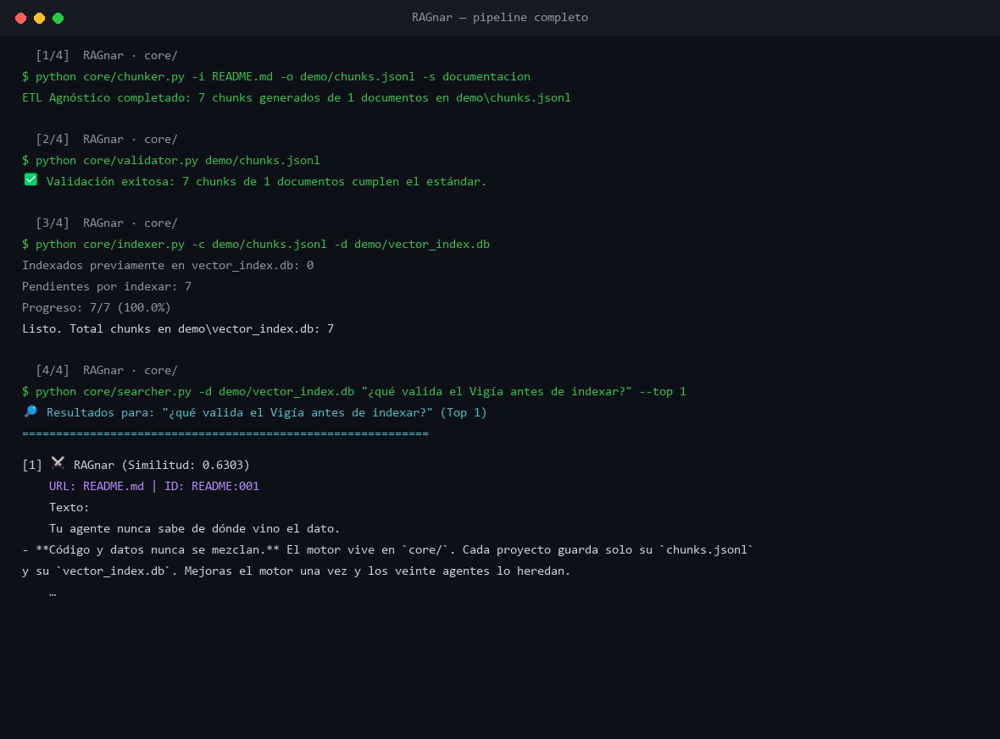
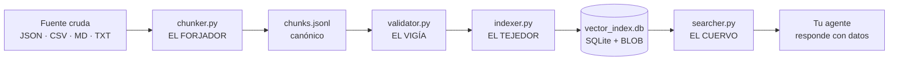

# ⚔️ RAGnar

[](https://www.python.org/)
[](https://sqlite.org/)
[](https://numpy.org/)
[](LICENSE)

### El framework que convierte el caos de tus datos en conocimiento consultable.

> **Ragnarök para tu desorden. Valhalla para tus datos.**



<p align="center"><a href="assets/ragnar-demo.gif"><b>▶ Ver la demo animada</b></a> — ejecución real: 1 documento → 7 chunks → 7 vectores → búsqueda semántica.</p>

RAGnar es un marco de ingeniería de datos para **RAG (Retrieval-Augmented Generation)** que recoge cualquier fuente — JSON de scrapers, CSV, Markdown, transcripciones, carpetas enteras — y la convierte en una base de conocimiento consultable en milisegundos. Sin Docker. Sin servidores residentes. Sin código duplicado en cada proyecto.

Nació resolviendo un problema real: **152 vídeos, 1.264 fragmentos, 768 dimensiones y 2 milisegundos de respuesta** sobre un portátil, no sobre un clúster.

---

## 🪓 ¿Por qué RAGnar?

- **Un contrato, infinitas fuentes.** Da igual si entra un JSON de scraper o una carpeta con 300 Markdown: sale siempre el mismo esquema canónico. Tu agente nunca sabe de dónde vino el dato.
- **Código y datos nunca se mezclan.** El motor vive en `core/`. Cada proyecto guarda solo su `chunks.jsonl` y su `vector_index.db`. Mejoras el motor una vez y los veinte agentes lo heredan.
- **Cero infraestructura pesada.** Python + SQLite + NumPy. Nada de contenedores, ni bases vectoriales cliente-servidor, ni procesos comiendo RAM en segundo plano.
- **Reanudable por diseño.** Si la API se cae a mitad de indexación, RAGnar retoma donde iba. Los 1.264 vectores de la prueba se hicieron en tres sesiones sin perder un solo chunk.

---

## 🛡️ Los Cuatro Mandatos

Todo corpus pasa por el mismo ritual, en este orden y sin atajos:



| Mandato | Módulo | Qué hace | Comando |
|---|---|---|---|
| **Forjar** | `core/chunker.py` | Trocea y limpia cualquier formato en fragmentos de ~1.000 caracteres con solapamiento alineado a oraciones. | `python core/chunker.py -i datos.json -o mi-proyecto/fuente/chunks.jsonl -s mi_fuente` |
| **Vigilar** | `core/validator.py` | Valida las 7 claves canónicas, los tipos y la numeración secuencial antes de gastar un céntimo en embeddings. | `python core/validator.py mi-proyecto/fuente/chunks.jsonl` |
| **Tejer** | `core/indexer.py` | Genera embeddings Gemini (768 dim) y los persiste en SQLite con control de tasa y reanudación. | `python core/indexer.py -c mi-proyecto/fuente/chunks.jsonl -d mi-proyecto/fuente/vector_index.db` |
| **Invocar** | `core/searcher.py` | Similitud coseno vectorizada con NumPy directo sobre SQLite. Respuestas en ~2 ms. Admite `--min-score` para descartar fragmentos fuera de tema. | `python core/searcher.py -d mi-proyecto/fuente/vector_index.db "tu pregunta" --top 3 --min-score 0.65` |

---

## 🚀 Inicio Rápido

```bash
# 0. Requisitos: Python 3.10+
pip install -r core/requirements.txt

# 1. FORJAR: cualquier fuente -> chunks.jsonl
python core/chunker.py -i datos.json -o mi-proyecto/fuente/chunks.jsonl -s mi_fuente

# 2. VIGILAR: esquema, tipos y secuencia
python core/validator.py mi-proyecto/fuente/chunks.jsonl

# 3. TEJER: 768 dimensiones por fragmento
export GEMINI_API_KEY="tu_api_key"      # Windows: $env:GEMINI_API_KEY="..."
python core/indexer.py -c mi-proyecto/fuente/chunks.jsonl -d mi-proyecto/fuente/vector_index.db

# 4. INVOCAR: pregunta y recupera
python core/searcher.py -d mi-proyecto/fuente/vector_index.db "¿cómo negocio un salario?" --top 3 --min-score 0.65
```

Salida real del cuervo:

```text
🔎 Resultados para: "como negociar un salario" (Top 3)
[1] ¿Cómo pedir un aumento de sueldo? (Similitud: 0.7482)
    URL: https://www.youtube.com/watch?v=... | ID: videoId:012
```

---

## 📁 Estructura

```text
ragnar-lightweight-rag-framework/
├── README.md
├── LICENSE
├── assets/                     # captura y demo animada del CLI
├── .gitignore                  # este repo es solo el motor
└── core/
    ├── chunker.py              # EL FORJADOR — ETL agnóstico
    ├── validator.py            # EL VIGÍA — QA del esquema
    ├── indexer.py              # EL TEJEDOR — embeddings -> SQLite
    ├── searcher.py             # EL CUERVO — búsqueda semántica
    ├── config.py               # credenciales, sin secretos en código
    ├── requirements.txt
    ├── .env.example
    └── README.md               # documentación técnica detallada
```

Los datos viven fuera: `mi-proyecto/<fuente>/chunks.jsonl` + `vector_index.db`. Nada de corpus en el repositorio, ni por error: el `.gitignore` bloquea todo lo que no sea `core/`.

---

## 📜 El Contrato Canónico

Una línea, un objeto, siete campos obligatorios:

```json
{
  "chunk_id": "fuente_001:000",
  "source_id": "fuente_001",
  "title": "Título del Documento",
  "url": "https://origen.com/doc",
  "chunk_index": 0,
  "source": "youtube",
  "text": "Contenido del fragmento troceado...",
  "meta": {}
}
```

`chunk_id` es siempre `source_id:NNN` con numeración secuencial desde 0. `validator.py` lo hace cumplir; `indexer.py` se niega a indexar si algo no encaja.

---

## ⚙️ Principios de Diseño

| Principio | Implementación |
|---|---|
| **Código y datos separados** | El motor en `core/`; cada fuente aporta solo sus datos. |
| **Un contrato único** | Todo input se normaliza al mismo esquema de 7 campos. |
| **Aislamiento vectorial** | Una SQLite por fuente y agente: sin contaminación cruzada, reindexación atómica. |
| **Cero infraestructura pesada** | Python nativo + SQLite + NumPy. |
| **Sin secretos en código** | `config.py` resuelve la API key desde entorno, archivo o Vault. |

---

## 🔑 Credenciales

`core/config.py` busca la API key en este orden: `GEMINI_API_KEY` → `GEMINI_KEY_FILE` → `.gemini_api_key` junto al script o al índice → Vault local de OpenBot. Nunca se versiona ninguna clave.

---

## 🔮 Hacia Dónde Crece

- **Documentos complejos:** extractores OCR y tabulares (`pdfplumber`, `marker`) antes de `chunker.py`.
- **Búsqueda híbrida:** SQLite FTS5 (BM25) combinada con la similitud vectorial en `searcher.py`.
- **Escala masiva:** cambiar el motor interno de `indexer.py` por LanceDB sin tocar el contrato ni el resto del pipeline.

---

## 🧭 Para Quién Es

Para quien construye agentes con conocimiento propio y no quiere montar un data lake para 4.000 parágrafos. Para quien valora que el pipeline se entienda en cinco minutos y se pueda auditar en diez.

**Un corpus. Cuatro mandatos. Cero humo.**

---

## 📄 Licencia

MIT — úsalo, modifícalo y véndelo si te sirve. Ver [`LICENSE`](LICENSE).

---

Documentación técnica completa: [`core/README.md`](core/README.md)
