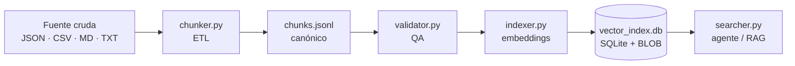

# Framework RAG Lightweight

Marco de ingeniería de datos modular y agnóstico a formatos para construir bases de conocimiento para **RAG (Retrieval-Augmented Generation)** en arquitecturas multi-agente, sin infraestructura pesada ni servidores en segundo plano.

Un pipeline completo en cuatro etapas — **ETL → QA → Vectorización → Búsqueda** — con código compartido y datos aislados por fuente.

---

## 📁 Estructura del Repositorio

```text
.
├── README.md
├── .gitignore
└── core/                       <-- MOTOR COMPARTIDO (todo el código)
    ├── chunker.py              # ETL universal y troceador semántico
    ├── validator.py            # QA y validador de esquema canónico
    ├── indexer.py              # Vectorizador con Gemini + SQLite
    ├── searcher.py             # Búsqueda semántica por similitud coseno
    ├── config.py               # Resolución de credenciales (sin secretos en código)
    ├── requirements.txt
    ├── .env.example
    └── README.md               # Documentación técnica detallada
```

El repositorio contiene **solo el motor**. Los datos derivados (`chunks.jsonl`, `vector_index.db`) se generan en carpetas externas y nunca se versionan.

---

## 🏛️ Principios de Diseño

| Principio | Implementación |
|---|---|
| **Código y datos separados** | El motor vive en `core/`; cada fuente solo aporta su `chunks.jsonl` y su `vector_index.db`. |
| **Un contrato único** | Todo input (JSON, JSONL, CSV, TSV, MD, TXT o carpeta mixta) se normaliza al mismo esquema de 7 campos. |
| **Aislamiento vectorial** | Una base SQLite por fuente y agente: sin contaminación cruzada, reindexaciones atómicas. |
| **Cero infraestructura pesada** | Python nativo + SQLite + NumPy. Sin Docker, sin servidores vectoriales residentes. |

**Esquema canónico** (`chunks.jsonl`, un objeto por línea):

```json
{
  "chunk_id": "fuente_001:000",
  "source_id": "fuente_001",
  "title": "Título del Documento",
  "url": "https://origen.com/doc",
  "chunk_index": 0,
  "source": "youtube",
  "text": "Contenido del fragmento troceado...",
  "meta": {}
}
```

---

## 🚀 Inicio Rápido

```bash
# 0. Requisitos (Python 3.10+)
pip install -r core/requirements.txt

# 1. ETL: cualquier fuente -> chunks.jsonl canónico
python core/chunker.py -i datos.json -o mi-proyecto/fuente/chunks.jsonl -s mi_fuente

# 2. QA: valida esquema, tipos y numeración secuencial
python core/validator.py mi-proyecto/fuente/chunks.jsonl

# 3. Vectorización (embeddings Gemini, 768 dim)
export GEMINI_API_KEY="tu_api_key"
python core/indexer.py -c mi-proyecto/fuente/chunks.jsonl -d mi-proyecto/fuente/vector_index.db

# 4. Búsqueda semántica (~2 ms por consulta)
python core/searcher.py -d mi-proyecto/fuente/vector_index.db "tu pregunta" --top 3
```

Flujo del pipeline:



---

## 🔑 Credenciales

`config.py` resuelve la API key en este orden: `GEMINI_API_KEY` en el entorno → `GEMINI_KEY_FILE` → archivo `.gemini_api_key` junto al script o al índice → Vault local de OpenBot. Ninguna credencial se incrusta ni se versiona.

---

## 🔮 Extensibilidad

- **Documentos complejos:** extractores OCR/tabulares (`pdfplumber`, `marker`) antes de `chunker.py`.
- **Búsqueda híbrida:** SQLite FTS5 (BM25) combinada con la similitud vectorial en `searcher.py`.
- **Escala masiva:** sustituir el motor interno de `indexer.py` por LanceDB manteniendo el resto del contrato intacto.

Documentación técnica completa: [`core/README.md`](core/README.md).
