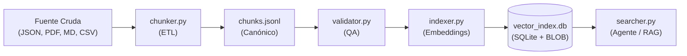

# ⚔️ RAGnar · Núcleo del Framework (Core)

Marco de ingeniería de datos modular, ligero y agnóstico a formatos para construir y desplegar sistemas de **RAG (Retrieval-Augmented Generation)** en arquitecturas multi-agente sin infraestructura pesada ni servidores en segundo plano.

Este directorio es el motor de **RAGnar**: los cuatro módulos del pipeline más la configuración de credenciales. Los datos (`chunks.jsonl`, `vector_index.db`) viven fuera, en la carpeta de cada proyecto.

---

## 🏛️ Principios de Diseño

1. **Separación Estricta entre Código y Datos:**  
   Todo el motor de procesamiento vive centralizado en `rag/core/`. Las carpetas de agentes (`rag/<agente>/<fuente>/`) son contenedores **100% de datos** (`chunks.jsonl` y `vector_index.db`), garantizando mantenibilidad y cero duplicación de scripts.

2. **Contrato Único e Inviolable:**  
   Independientemente de si la fuente original es un JSON de scraper, una transcripción de YouTube, un PDF, un CSV o una carpeta de Markdown, todo se normaliza al esquema canónico estandarizado:
   ```json
   {
     "chunk_id": "fuente_001:000",
     "source_id": "fuente_001",
     "title": "Título del Documento",
     "url": "https://origen.com/doc",
     "chunk_index": 0,
     "source": "youtube",
     "text": "Contenido del fragmento troceado...",
     "meta": {}
   }
   ```

3. **Espacios Vectoriales Aislados por Agente y Fuente:**  
   Cada fuente posee su propia base SQLite vectorial (`vector_index.db`). Esto elimina el riesgo de contaminación cruzada entre agentes y permite copias de seguridad, eliminaciones o reindexaciones atómicas e independientes.

4. **Cero Infraestructura Pesada (Zero-Heavy Infra):**  
   Implementado con **Python nativo, SQLite y NumPy**. No requiere contenedores Docker, bases vectoriales cliente-servidor residentes ni consumo pasivo de memoria RAM. Las búsquedas por similitud coseno se resuelven en ~2 milisegundos.

---

## 📦 Componentes del Framework

| Módulo | Tipo | Función | Uso |
|---|---|---|---|
| **`chunker.py`** | **ETL** | Ingesta agnóstica multiformato (.json, .jsonl, .csv, .tsv, .md, .txt o carpetas completas). Limpia el texto y genera fragmentos de ~1.000 caracteres con solapamiento inteligente alineado a oraciones naturales. | `python chunker.py -i input.json -o chunks.jsonl -s youtube` |
| **`validator.py`** | **QA** | Validador estricto de integridad. Comprueba las 7 claves canónicas, tipos de datos, formato de `chunk_id == source_id:NNN` y numeración secuencial base 0. | `python validator.py chunks.jsonl` |
| **`indexer.py`** | **Vectores** | Indexador semántico. Genera embeddings (Gemini 768 dim o BGE-M3 local 1024 dim) y persiste texto y vectores en SQLite (`vector_index.db`) con reanudación, control de tasa y el motor grabado en la tabla `meta`. | `python indexer.py -c chunks.jsonl -d vector_index.db [--provider ollama]` |
| **`searcher.py`** | **Buscador** | Motor de búsqueda por similitud coseno vectorizada. Vectoriza la consulta con el motor del índice y, si ese motor falla, responde con el índice local gemelo (`*.bge.db`). Admite umbral de relevancia. | `python searcher.py -d vector_index.db "pregunta" --top 3 --min-score 0.65` |
| **`embedders.py`** | **Motores** | Fábrica de proveedores de embeddings: Gemini (nube) y Ollama/BGE-M3 (local). Detecta qué está disponible, evita reintentos inútiles ante 402/429 y lee y escribe los metadatos del índice. | — |
| **`config.py`** | **Credenciales** | Resuelve la API key (`GEMINI_API_KEY` → `GEMINI_KEY_FILE` → `.gemini_api_key` → Vault local). Sin secretos incrustados. | — |

---

## 🚀 Flujo de Trabajo para Nuevas Fuentes



### Comandos del Pipeline:
```bash
# 1. Transformación ETL a chunks
python rag/core/chunker.py -i ruta/datos.json -o rag/mi-agente/fuente/chunks.jsonl -s mi_fuente

# 2. Control de Calidad
python rag/core/validator.py rag/mi-agente/fuente/chunks.jsonl

# 3. Vectorización
python rag/core/indexer.py -c rag/mi-agente/fuente/chunks.jsonl -d rag/mi-agente/fuente/vector_index.db

# 4. Consulta semántica desde el Agente
python rag/core/searcher.py -d rag/mi-agente/fuente/vector_index.db "consulta" --top 3 --min-score 0.65
```

### Umbral de relevancia (`--min-score`)

El coseno devuelve siempre un "ganador", incluso si el tema no está en el corpus. `--min-score` corta esa falsa respuesta. **Cada motor puntúa en su propia escala**, así que el umbral se elige solo si no se pasa nada:

| Motor | Dentro del corpus | Fuera del corpus | Umbral por defecto |
|---|---|---|---|
| `gemini` | 0.630 – 0.794 | 0.540 – 0.568 | **0.60** |
| `ollama` (BGE-M3) | 0.589 – 0.679 | 0.410 – 0.486 | **0.54** |

Medido sobre 1.264 chunks y 10 preguntas (6 dentro, 4 fuera) del corpus de Michelle Engelmann. Reutilizar el 0.65 de Gemini con BGE-M3 rechazaría preguntas legítimas: su escala es ~0.12 más baja.

```bash
# Umbral calibrado del motor, sin pasarlo a mano
python core/searcher.py -d mi.db "negociar salario"

# Umbral explícito (manda sobre el calibrado); 0 desactiva el filtro
python core/searcher.py -d mi.db "negociar salario" --min-score 0.7
```

Si no se pasa, el comportamiento es el del umbral del motor. Con `--json` en una base vacía o sin coincidencias se imprime `[]`.

---

## 🧪 Tests

```bash
# 16 tests offline: metadatos, umbrales, rechazo a mezclar motores. Sin red ni API key.
python -m unittest discover -s tests -v

# Tests de recuperación contra un corpus real (leen red u Ollama; se saltan sin RAG_E2E=1)
RAG_E2E=1 python -m unittest tests.test_retrieval -v

# Otro corpus
RAG_CORPUS="ruta/al/vector_index.db" RAG_E2E=1 python -m unittest tests.test_retrieval -v
```

Los tests de recuperación son preguntas de oro: comprueban que cada motor sigue encontrando lo que encontraba y que sigue callando ante preguntas fuera de tema. Son la red de seguridad ante cambios de motor, troceado o umbral.

---

## 🔑 Credenciales

Ningún script contiene claves. `config.py` busca la API key en este orden:

1. Variable de entorno `GEMINI_API_KEY` (o `GOOGLE_API_KEY`)
2. Archivo apuntado por `GEMINI_KEY_FILE`
3. Archivo `.gemini_api_key` junto al script, al directorio actual o al `vector_index.db`
4. Vault local de OpenBot (`%APPDATA%/OpenBot/agent-api-keys/.vault/*/GEMINI_API_KEY`)

**Ojo con el paso 4:** recorre todas las carpetas de agentes y se queda con la primera por orden alfabético, no con la del agente que ejecuta. Si hay varias claves distintas en el vault, se puede estar usando otra sin saberlo: revisa que todas apunten a la misma o usa `GEMINI_API_KEY` explícita.

---

## 🧠 Motores de embeddings y respaldo automático

`embedders.py` desacopla el motor que vectoriza del resto del pipeline. Dos opciones con la misma interfaz:

| Motor | Modelo | Dimensiones | Necesita | Coste |
|---|---|---|---|---|
| `gemini` | Gemini Embedding | 768 | API key con cuota | Cuota del plan |
| `ollama` | BGE-M3 local | 1024 | Ollama + `ollama pull bge-m3` | $0, en tu equipo |

### Regla de oro: un índice, un motor

768 y 1024 dimensiones no se pueden comparar entre sí. El motor con el que se construyó cada índice queda grabado en su tabla `meta`:

```bash
sqlite3 mi.db "select key,value from meta"
# embedding_provider|ollama
# embedding_model|bge-m3:latest
# embedding_dim|1024
```

Por eso, al consultar, `searcher.py` vectoriza la pregunta **con el motor del índice**, no con el que esté de moda. Cambiar de motor exige reindexar:

```bash
# Índice principal con Gemini (768)
python core/indexer.py -c chunks.jsonl -d mi.db --provider gemini

# Índice gemelo con BGE-M3 local (1024)
python core/indexer.py -c chunks.jsonl -d mi.bge.db --provider ollama

# Cambiar un índice existente de motor: --rebuild (borra vectores; los datos siguen en chunks.jsonl)
python core/indexer.py -c chunks.jsonl -d mi.db --provider ollama --rebuild
```

### Respaldo automático

Con `--provider auto` (defecto), el indexador prefiere Gemini y usa BGE-M3 si Gemini no puede atender (402 sin saldo, 401 clave inválida, 429 sin cuota, o Ollama presente y Gemini caído).

En la búsqueda, si el motor del índice falla, `searcher.py` busca el índice hermano `<nombre>.bge.db` y responde con él, avisando por stderr y marcando el resultado:

```bash
python core/searcher.py -d mi.db "pregunta" --top 3 --min-score 0.65
# ⚠️ Gemini devuelve 402... → Respondiendo con el índice local mi.bge.db (BGE-M3).
#     Motor: ollama · RESPALDO LOCAL
```

| Flag | Efecto |
|---|---|
| `--provider gemini\|ollama\|auto` | Elige motor (en búsqueda, solo si coincide con el del índice) |
| `--no-fallback` | Falla en vez de usar el índice local |
| `--fallback-db <ruta>` | Respaldo explícito en lugar del hermano `*.bge.db` |
| `--rebuild` (indexador) | Borra los vectores y rehace el índice con el motor pedido |

Variables de entorno: `RAG_EMBED_PROVIDER`, `OLLAMA_HOST` (defecto `http://127.0.0.1:11434`), `RAG_OLLAMA_MODEL` (defecto `bge-m3`).

**Coste medido** (CPU de 8 núcleos, sin GPU): BGE-M3 indexa ~0,6 chunks/s (~34 min para 1.264 chunks) y responde una consulta en ~165 ms. Gemini indexa en 1–2 min pero depende de red y cuota, y responde en ~450 ms de ida y vuelta.

---

## 🔮 Extensibilidad Futura
- **Documentos complejos:** Integración con extractores OCR/tabulares (`pdfplumber`, `marker`) previo a `chunker.py`.
- **Búsqueda Híbrida:** Incorporación de SQLite FTS5 (BM25) en `searcher.py` para combinar precisión léxica con semántica vectorial.
