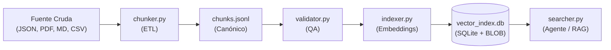

# Marco de Trabajo RAG Lightweight (Core Framework)

Marco de ingeniería de datos modular, ligero y agnóstico a formatos para construir y desplegar sistemas de **RAG (Retrieval-Augmented Generation)** en arquitecturas multi-agente sin infraestructura pesada ni servidores en segundo plano.

---

## 🏛️ Principios de Diseño

1. **Separación Estricta entre Código y Datos:**  
   Todo el motor de procesamiento vive centralizado en `rag/core/`. Las carpetas de agentes (`rag/<agente>/<fuente>/`) son contenedores **100% de datos** (`chunks.jsonl` y `vector_index.db`), garantizando mantenibilidad y cero duplicación de scripts.

2. **Contrato Único e Inviolable:**  
   Independientemente de si la fuente original es un JSON de scraper, una transcripción de YouTube, un PDF, un CSV o una carpeta de Markdown, todo se normaliza al esquema canónico estandarizado:
   ```json
   {
     "chunk_id": "fuente_001:000",
     "source_id": "fuente_001",
     "title": "Título del Documento",
     "url": "https://origen.com/doc",
     "chunk_index": 0,
     "source": "youtube",
     "text": "Contenido del fragmento troceado...",
     "meta": {}
   }
   ```

3. **Espacios Vectoriales Aislados por Agente y Fuente:**  
   Cada fuente posee su propia base SQLite vectorial (`vector_index.db`). Esto elimina el riesgo de contaminación cruzada entre agentes y permite copias de seguridad, eliminaciones o reindexaciones atómicas e independientes.

4. **Cero Infraestructura Pesada (Zero-Heavy Infra):**  
   Implementado con **Python nativo, SQLite y NumPy**. No requiere contenedores Docker, bases vectoriales cliente-servidor residentes ni consumo pasivo de memoria RAM. Las búsquedas por similitud coseno se resuelven en ~2 milisegundos.

---

## 📦 Componentes del Framework

| Módulo | Tipo | Función | Uso |
|---|---|---|---|
| **`chunker.py`** | **ETL** | Ingesta agnóstica multiformato (.json, .jsonl, .csv, .tsv, .md, .txt o carpetas completas). Limpia el texto y genera fragmentos de ~1.000 caracteres con solapamiento inteligente alineado a oraciones naturales. | `python chunker.py -i input.json -o chunks.jsonl -s youtube` |
| **`validator.py`** | **QA** | Validador estricto de integridad. Comprueba las 7 claves canónicas, tipos de datos, formato de `chunk_id == source_id:NNN` y numeración secuencial base 0. | `python validator.py chunks.jsonl` |
| **`indexer.py`** | **Vectores** | Indexador semántico. Genera embeddings normalizados (Gemini Matryoshka 768 dim) y persiste texto y vectores en SQLite (`vector_index.db`) con soporte para reanudación y control de tasa (rate limiting). | `python indexer.py -c chunks.jsonl -d vector_index.db` |
| **`searcher.py`** | **Buscador** | Motor de búsqueda por similitud coseno vectorizada. Consultable vía CLI o integrable como módulo por cualquier agente. | `python searcher.py -d vector_index.db "pregunta" --top 3` |
| **`config.py`** | **Credenciales** | Resuelve la API key (`GEMINI_API_KEY` → `GEMINI_KEY_FILE` → `.gemini_api_key` → Vault local). Sin secretos incrustados. | — |

---

## 🚀 Flujo de Trabajo para Nuevas Fuentes



### Comandos del Pipeline:
```bash
# 1. Transformación ETL a chunks
python rag/core/chunker.py -i ruta/datos.json -o rag/mi-agente/fuente/chunks.jsonl -s mi_fuente

# 2. Control de Calidad
python rag/core/validator.py rag/mi-agente/fuente/chunks.jsonl

# 3. Vectorización
python rag/core/indexer.py -c rag/mi-agente/fuente/chunks.jsonl -d rag/mi-agente/fuente/vector_index.db

# 4. Consulta semántica desde el Agente
python rag/core/searcher.py -d rag/mi-agente/fuente/vector_index.db "consulta" --top 3
```

---

## 🔑 Credenciales

Ningún script contiene claves. `config.py` busca la API key en este orden:

1. Variable de entorno `GEMINI_API_KEY` (o `GOOGLE_API_KEY`)
2. Archivo apuntado por `GEMINI_KEY_FILE`
3. Archivo `.gemini_api_key` junto al script, al directorio actual o al `vector_index.db`
4. Vault local de OpenBot (`%APPDATA%/OpenBot/agent-api-keys/.vault/*/GEMINI_API_KEY`)

---

## 🔮 Extensibilidad Futura
- **Documentos complejos:** Integración con extractores OCR/tabulares (`pdfplumber`, `marker`) previo a `chunker.py`.
- **Búsqueda Híbrida:** Incorporación de SQLite FTS5 (BM25) en `searcher.py` para combinar precisión léxica con semántica vectorial.
